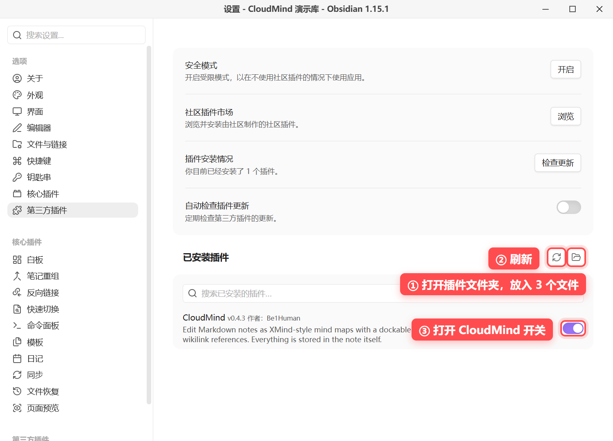
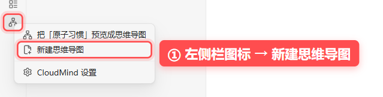
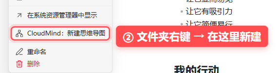
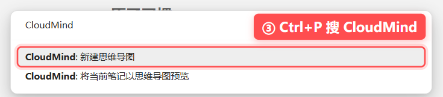
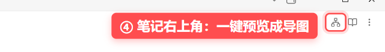
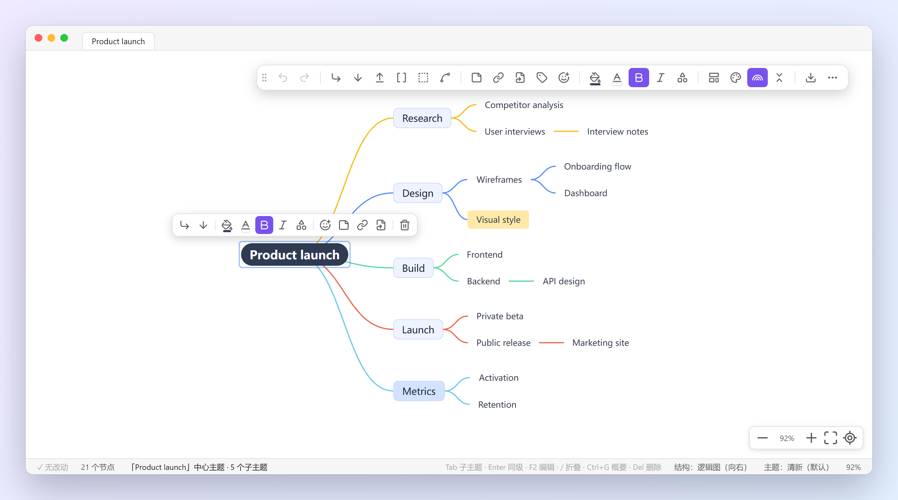
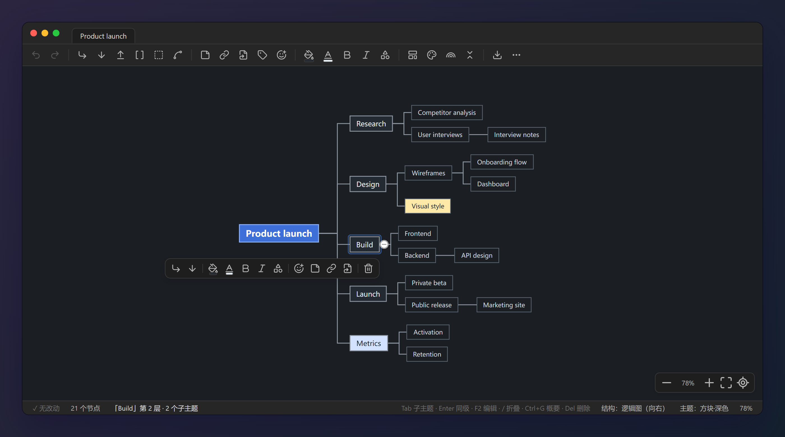

<div align="center">

# CloudMind

**XMind-style mind maps for Obsidian — stored as plain Markdown.**

**English** · [简体中文](README.zh-CN.md)

</div>


Your note **is** the mind map. Headings and lists become branches, and every edit is written straight back to the same `.md` file. Nothing to import, export or convert.

- **Plain Markdown.** Turn the plugin off and your notes are still readable headings and lists. Search, backlinks, graph view and sync all keep working.
- **Feels like XMind.** `Tab`, `Enter`, drag and drop, summaries, frames, relation lines, 10 themes and 8 layouts.
- **Links included.** Type `[[` in a node to link another note.

> Desktop only · Obsidian 1.5.0+ · The interface is in Simplified Chinese.

---

## Install

Obsidian installs plugins **per vault** (the folder you open in Obsidian), not into the app. Install CloudMind in each vault where you want to use it.

**From the community plugins list** (once listed): *Settings → Community plugins → Browse*, search **CloudMind**, install, enable.

**Manually** (available now):

1. Download `main.js`, `manifest.json` and `styles.css` from the [latest release](https://github.com/Be1Human/obsidian-cloudmind/releases/latest).
2. *Settings → Community plugins* → click the **folder icon** next to *Installed plugins*. In the folder that opens, create a folder named `cloudmind` and put the three files in it.
3. Click the **reload icon**, then switch **CloudMind** on.



<details>
<summary><b>Can't find the folder? / Several vaults / Update / Uninstall</b></summary>

**Can't find the folder?** Turn *Restricted mode* off first. You can also right-click any note → *Show in system explorer*, then open `.obsidian/plugins/` (a hidden folder). The result should be:

```
your-vault/.obsidian/plugins/cloudmind/
├─ main.js
├─ manifest.json
└─ styles.css
```

**Several vaults.** Repeat the steps in each vault, or copy the `cloudmind` folder over. To share one copy between vaults, link it (tested on Windows):

```bat
mklink /J "D:\Other vault\.obsidian\plugins\cloudmind" "D:\My vault\.obsidian\plugins\cloudmind"
```

On macOS / Linux: `ln -s ~/MyVault/.obsidian/plugins/cloudmind ~/OtherVault/.obsidian/plugins/cloudmind`. Sync services may not follow links; use separate copies in that case.

**Update.** Replace the three files, then reload plugins.

**Uninstall.** Switch it off or remove it in *Community plugins*. Your notes are plain Markdown and stay untouched.

</details>

---

## Create a mind map

| | How | |
|:-:|---|---|
| ① | **Ribbon icon** → `新建思维导图` (New mind map) |  |
| ② | **Right-click a folder** → `CloudMind：新建思维导图` |  |
| ③ | **`Ctrl+P`** → search “CloudMind” |  |
| ④ | **Existing note**: the mind-map button in the note header |  |
| ⑤ | **Existing note**: the CloudMind item in the status bar |  |

① – ③ create `未命名导图.md` (“Untitled map”) with a central topic and three branches. ④ – ⑤ preview the open note as a map; the file is only changed after you edit the map.

To always open a note as a map, add `cloudmind: true` to its front matter. New maps already have it.

---

## Features

<table>
<tr>
<td width="50%"><br><b>10 themes</b>, four of them with every node framed in a box.</td>
<td width="50%"><br><b>[[Wikilinks]] in nodes</b>, shown as underlined note names. <code>Ctrl</code>+click opens the note.</td>
</tr>
<tr>
<td><br><b>Toolbar anywhere:</b> top, bottom, left, right, floating or hidden.</td>
<td><br><b>Dark mode.</b> Custom colours stay readable.</td>
</tr>
</table>

- **8 layouts**: mind map, logic chart (right / left), org chart, catalog, timeline, vertical timeline, fishbone.
- **Rich topics**: notes, hyperlinks, tags, icons, colours, shapes, summaries, frames, relation lines.
- **Quick bar** next to the selected topic and a **status bar** with save state and hints.
- **Smooth** trackpad and mouse-wheel panning and zooming.
- **Export** to PNG, SVG and `.xmind`.

---

## How a note is stored

```markdown
---
cloudmind: true
cloudmind-layout: logicalStructure
cloudmind-theme: cloudBox
---
# Central topic
## Branch <!--mm:{"fillColor":"#FFE9A8"}-->
- Topic
  This line is the note of “Topic”
```

| What | Where |
|---|---|
| Structure | Heading and list nesting |
| Topic notes | Plain text lines under a topic (note lines starting with `-`, `1.` or `#` are saved as `\-`, `1\.`, `\#` so they don't become topics; they look the same in reading view) |
| Colours, folding, icons, links… | A hidden `<!--mm:{…}-->` comment at the end of the line |
| Layout and theme | Front matter: `cloudmind-layout`, `cloudmind-theme` |

<details>
<summary><b>Keyboard shortcuts</b></summary>

| Key | Action |
|---|---|
| `Tab` / `Enter` / `Shift+Tab` | Child / sibling / parent topic |
| Typing or `F2` | Edit topic |
| `Del` / `Backspace` | Delete topic with children |
| `Shift+Backspace` | Delete only the topic |
| `/` | Fold / unfold |
| `Ctrl+G` | Summary |
| `Ctrl+B` | Bold |
| `Ctrl+↑` / `Ctrl+↓` | Move up / down |
| `Ctrl+C` / `X` / `V` | Copy / cut / paste |
| `Ctrl+Z` / `Ctrl+Y` | Undo / redo |
| `Ctrl+L` / `Ctrl+I` | Tidy layout / fit to screen |
| `Ctrl`+click | Open linked note |

On macOS use `⌘` instead of `Ctrl`.

</details>

<details>
<summary><b>Development</b></summary>

```bash
npm ci
npm run dev           # watch build
npm run build         # production build
npm test              # round-trip and UI tests (needs Chromium)
npm run lint:review   # Obsidian community review lint
```

Release: `npm version <x.y.z>`, then push the commit and tag. GitHub Actions attaches `main.js`, `manifest.json` and `styles.css` to the release.

</details>

---

## License

[MIT](LICENSE). Built on [simple-mind-map](https://github.com/wanglin2/mind-map). Not affiliated with XMind ([notices](THIRD_PARTY_NOTICES.md)).
