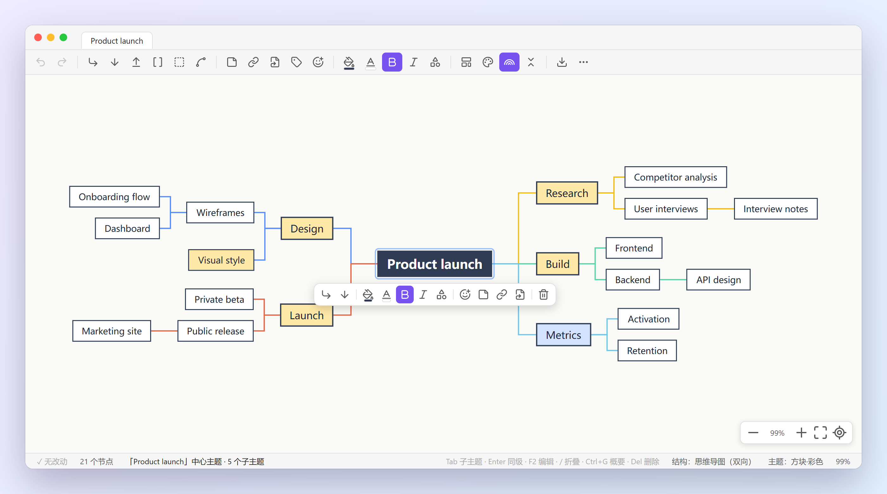
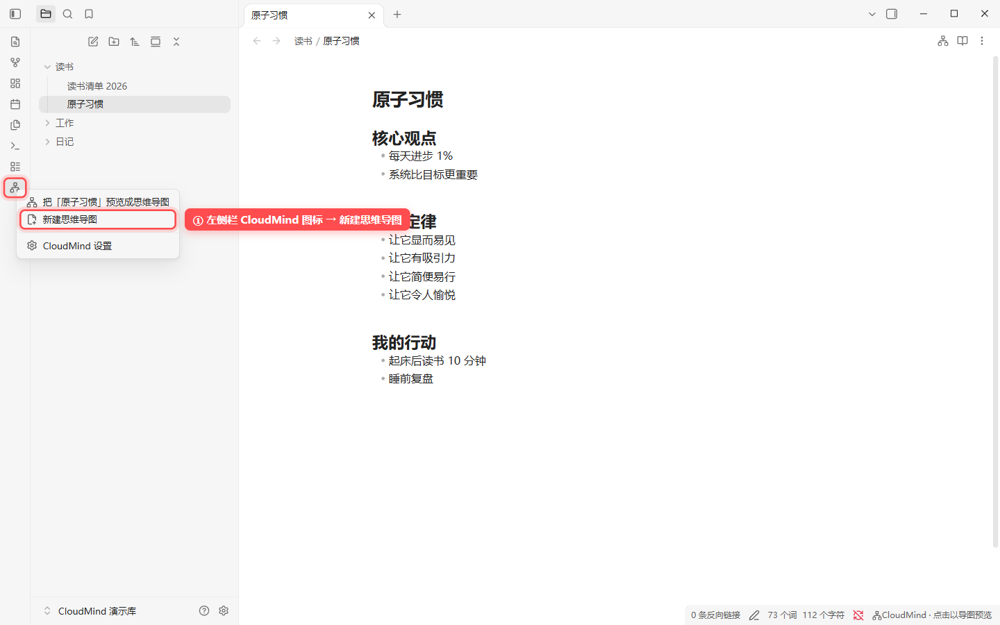
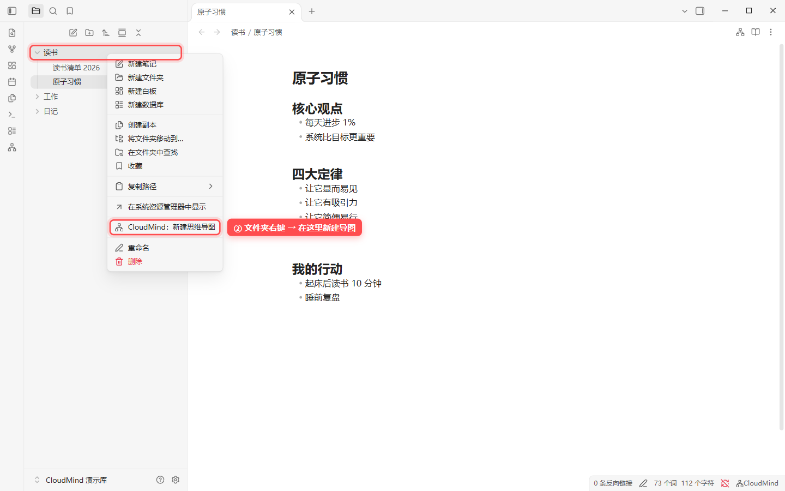
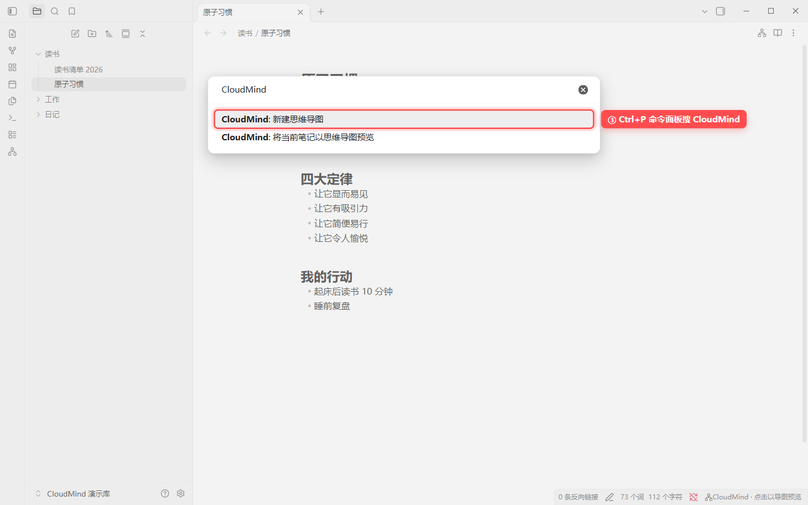
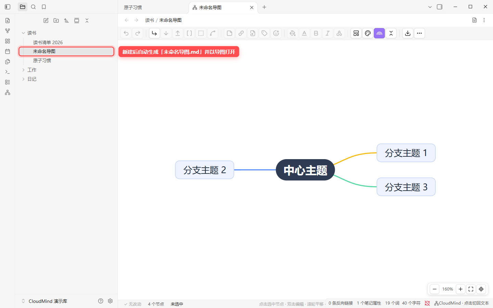
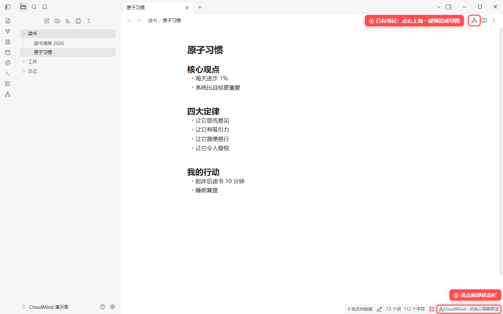
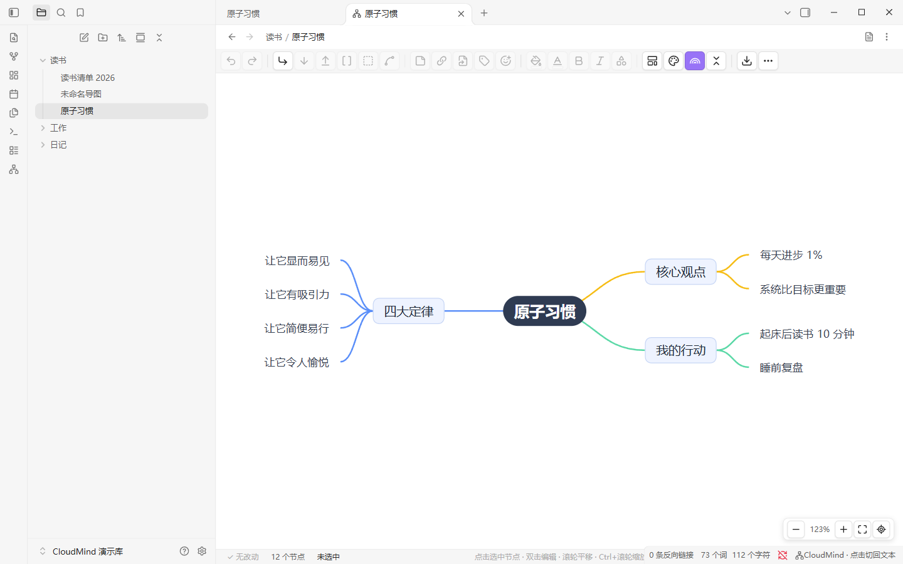
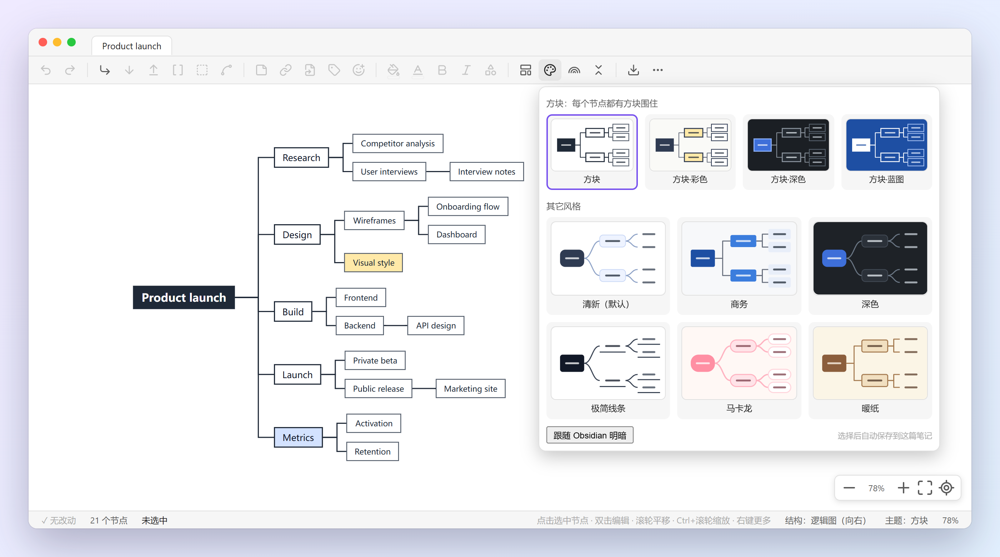
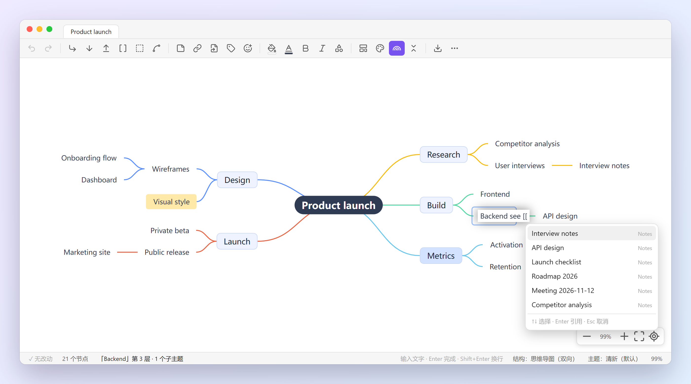
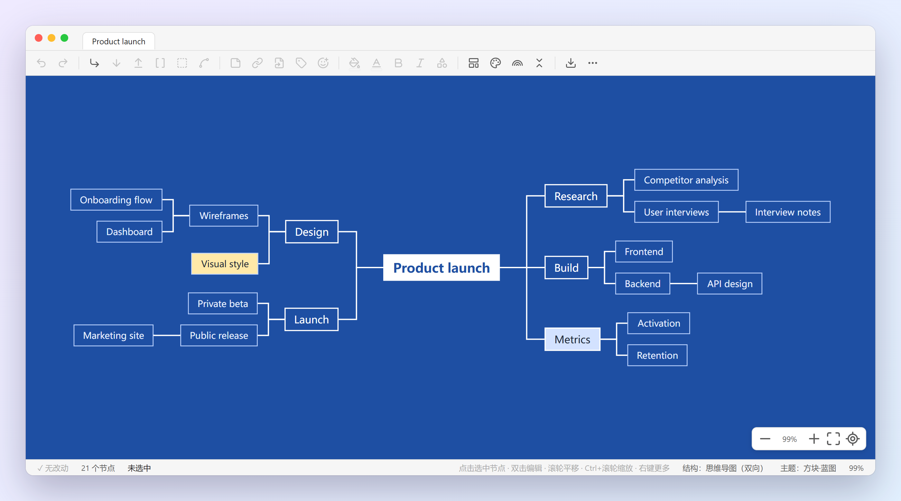

# CloudMind

**English** | [简体中文](README.zh-CN.md)

Edit your Markdown notes as **XMind-style mind maps** in Obsidian. Nothing is converted or exported: the map *is* the note. Headings and lists become branches, and every change is written straight back to the same `.md` file.

> Desktop only. The interface is currently in Chinese (简体中文) only.

> 中文用户请看 **[中文说明 README.zh-CN.md](README.zh-CN.md)**：安装、创建、编辑、快捷键、常见问题都有截图。



## Create a mind map · 如何创建导图

Real screenshots from Obsidian 1.10 with CloudMind installed (Chinese UI). Red boxes mark where to click.
以下是装好 CloudMind 后在 Obsidian 里的真实截图，红框是要点的位置。

### New mind map · 新建一张导图

**① Ribbon icon → 新建思维导图 (New mind map)**
左侧栏的 CloudMind 图标 → 新建思维导图



**② Right-click a folder → CloudMind：新建思维导图** — creates the map inside that folder
在文件列表里右键文件夹 → CloudMind：新建思维导图，导图会建在这个文件夹里



**③ Command palette (`Ctrl+P`) → search “CloudMind”**
命令面板（`Ctrl+P`）搜 CloudMind



**Result** — a new note `未命名导图.md` (“Untitled map”) is created with a central topic and three branches, and opens as a mind map. Rename it like any other note.
新建后会生成 `未命名导图.md`（一个中心主题 + 三个分支）并直接以导图打开，可以像普通笔记一样重命名。



### Turn an existing note into a map · 把已有笔记变成导图

**④ Note header button**, or **⑤ the CloudMind item in the status bar** — previews the open note as a mind map. Previewing never changes the file.
点笔记右上角的导图按钮，或底部状态栏的 CloudMind，把当前笔记预览成导图。只预览不会改动文件。





To make a note always open as a map, add `cloudmind: true` to its front matter (new maps already have it).
想让某篇笔记每次都以导图打开，在它的 frontmatter 里加 `cloudmind: true`（新建的导图已经自带）。

## Screenshots

| | |
|---|---|
|  |  |
| **Ten themes**, including four *box* themes where every node is framed. | **Floating toolbar** – drag the grip, or dock it on any side. |
|  |  |
| **Type `[[`** in a node to reference another note. | **Dark mode** – custom fills stay readable. |



## Features

- **Notes as mind maps** – headings (`#`) and nested lists (`-`) are the branches. Close the plugin and your notes are still plain, readable Markdown.
- **XMind-like editing** – `Tab` adds a child, `Enter` adds a sibling, `Shift+Tab` adds a parent, type to rename, `/` folds, `Ctrl+G` adds a summary, drag to reorder, undo and redo.
- **Dockable or floating toolbar** – top, bottom, left, right, floating (drag the grip, double-click to reset) or hidden.
- **Quick bar on the selected node** and a **status bar** showing the save state, node count, selection and hints.
- **Wikilinks** – type `[[` inside a node to search your notes. Nodes that contain links are underlined; `Ctrl`+click opens the note in a new tab.
- **10 themes** – including four *box* themes where every node is enclosed in a square frame – with a preview gallery.
- **8 structures** – mind map, logic chart (right/left), organization chart, catalog, timeline, vertical timeline, fishbone.
- **Rich nodes** – notes, hyperlinks, tags, icons, fill/text/border colours, shapes, summaries, outer frames and relation lines.
- **Smooth panning and zooming** – follows trackpad fingers, eases mouse-wheel steps, zooms around the pointer.
- **Export** – PNG, SVG and `.xmind`.

## How a note is stored

Everything lives in the note. There are no side-car files.

```markdown
---
cloudmind: true
cloudmind-layout: logicalStructure
cloudmind-theme: cloudBox
---
# Central topic
## Branch <!--mm:{"fillColor":"#FFE9A8"}-->
- Leaf
  - Deeper leaf
Text under a topic is its note.
```

| What | Where |
|---|---|
| Structure | Heading and list nesting |
| Topic note | Plain text lines under the topic |
| Style, fold state, icons, summaries, links… | A hidden `<!--mm:{…}-->` comment at the end of the line (invisible in reading view) |
| Structure and theme of the whole map | Front matter: `cloudmind-layout`, `cloudmind-theme`, `cloudmind-rainbow` |

A note opens as a mind map when its front matter contains `cloudmind: true`. Any other note can be previewed with the **CloudMind** button in the note header, the ribbon menu or the command palette. Previewing never modifies the file; it is only written after you edit something in the map.

## Usage

- Ribbon icon, note-header button, status-bar item, file context menu and command palette all open CloudMind.
- Commands: *New mind map*, *Preview current note as mind map*, *Switch current mind map back to text*, *Cycle toolbar position*.
- Settings: toolbar position, icon size, button labels, node quick bar, status bar and auto-open.

### Keyboard

| Key | Action |
|---|---|
| `Tab` / `Enter` / `Shift+Tab` | Child / sibling / parent topic |
| typing, `F2` | Edit the selected topic |
| `/` | Fold / unfold |
| `Ctrl+G` | Add summary |
| `Ctrl+B` | Bold |
| `Ctrl+↑` / `Ctrl+↓` | Move topic up / down |
| `Ctrl+C` / `X` / `V` | Copy / cut / paste topics |
| `Ctrl+Z` / `Ctrl+Y` | Undo / redo |
| `Ctrl+A` | Select all |
| `Ctrl+L` | Tidy layout |
| `Ctrl+I` | Fit to canvas |
| `Del` | Delete (`Shift+Backspace` deletes only the topic, keeping children) |
| `Ctrl`+click | Open the note linked in a topic |

## Installation

### From the community plugins list

Open *Settings → Community plugins*, search for **CloudMind**, install and enable it.

### Manual

Download `main.js`, `manifest.json` and `styles.css` from the latest release into `<vault>/.obsidian/plugins/cloudmind/`, then enable the plugin.

## Notes and limitations

- Desktop only (it uses a browser-based mind map engine that bundles Node's `stream`).
- The interface is Chinese only for now.
- Notes that contain another mind-map plugin's front matter (for example `mindmap-plugin`) are left alone; CloudMind only looks at `cloudmind`.
- Not affiliated with XMind. See [THIRD_PARTY_NOTICES.md](THIRD_PARTY_NOTICES.md).

## Development

```bash
npm ci
npm run dev        # watch build
npm run build      # production build -> main.js
npm run typecheck
npm test           # Markdown round-trip tests + headless-browser UI tests (needs a local Chromium)
```

To release: bump `version` in `package.json` with `npm version <x.y.z>` (this also updates `manifest.json` and `versions.json`), push the commit and the tag. The workflow in `.github/workflows/release.yml` builds and attaches `main.js`, `manifest.json` and `styles.css`.

## License

[MIT](LICENSE). Built on [simple-mind-map](https://github.com/wanglin2/mind-map) (MIT).

---

## 中文说明

完整的中文使用教程（含真实截图）：**[README.zh-CN.md](README.zh-CN.md)**

还可以把 [docs/CloudMind使用教程.md](docs/CloudMind使用教程.md) 放进你的库里打开：它本身就是一张导图，边看边练。
