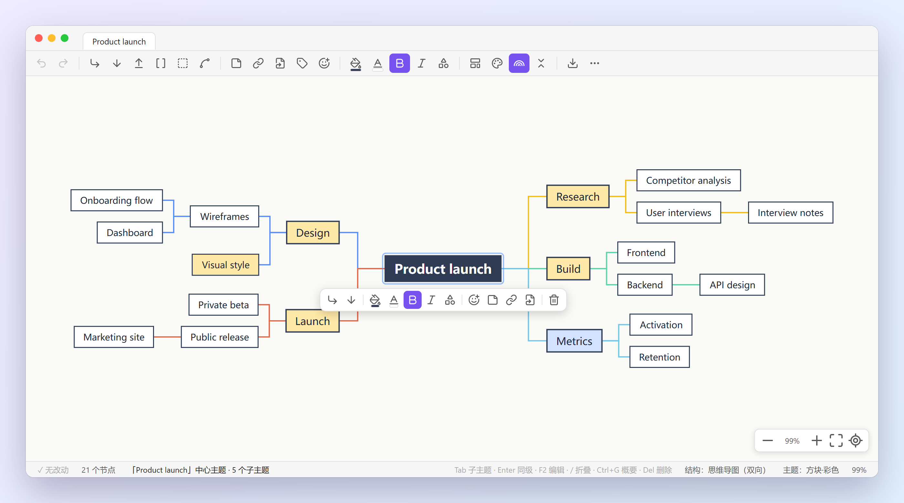
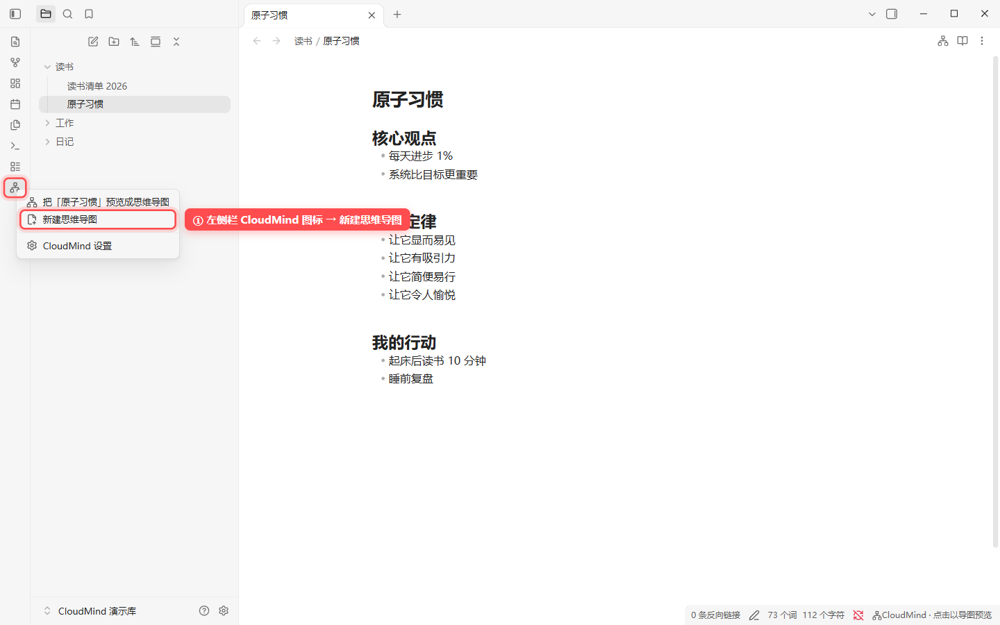
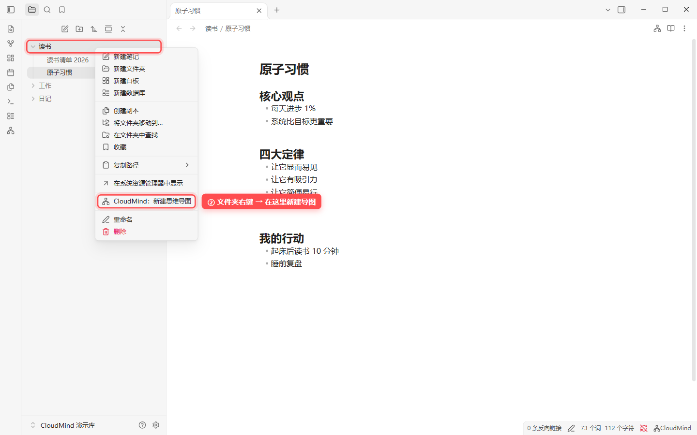
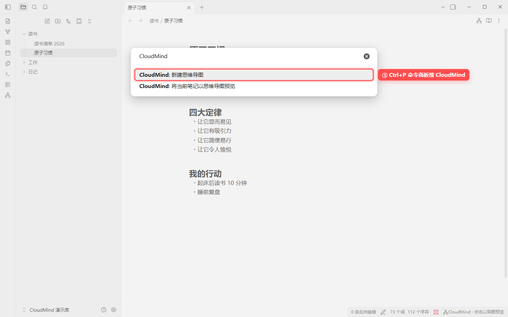
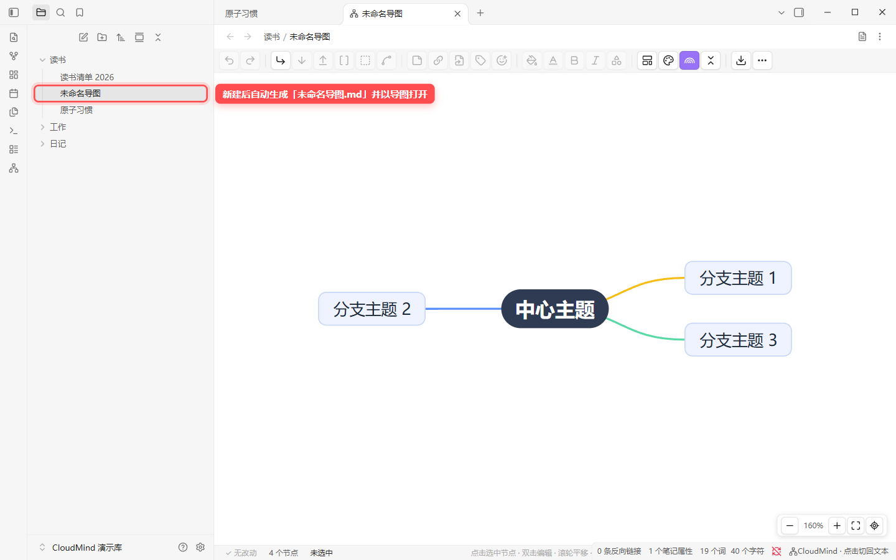
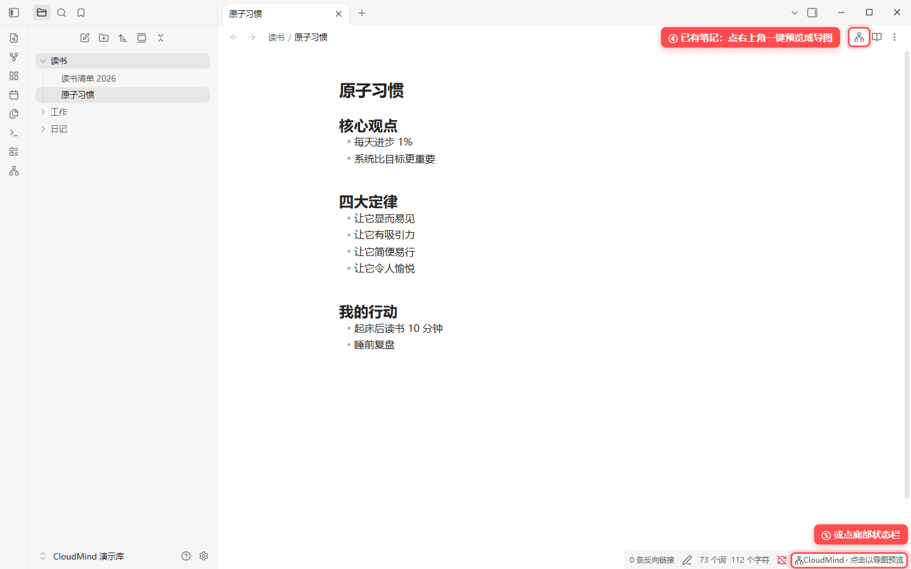
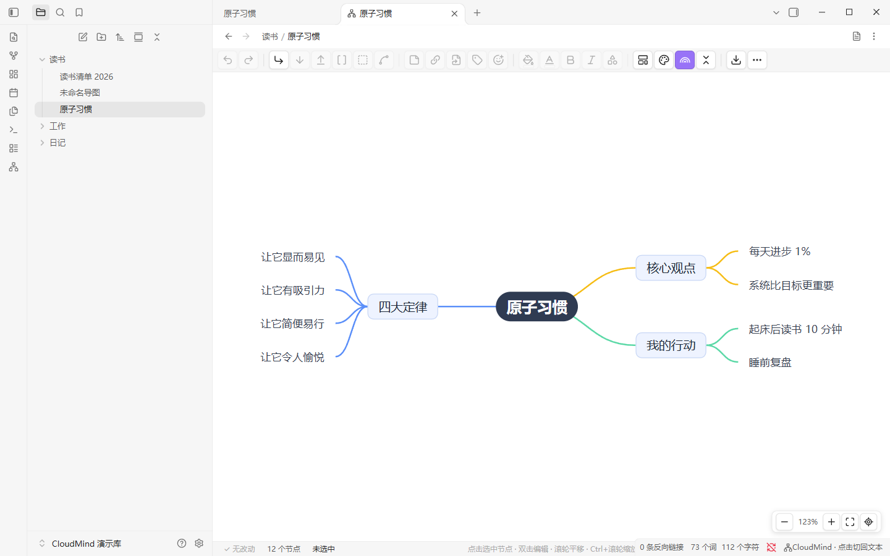
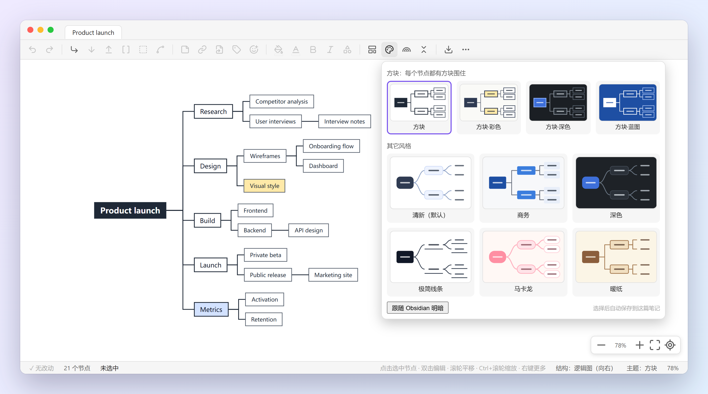
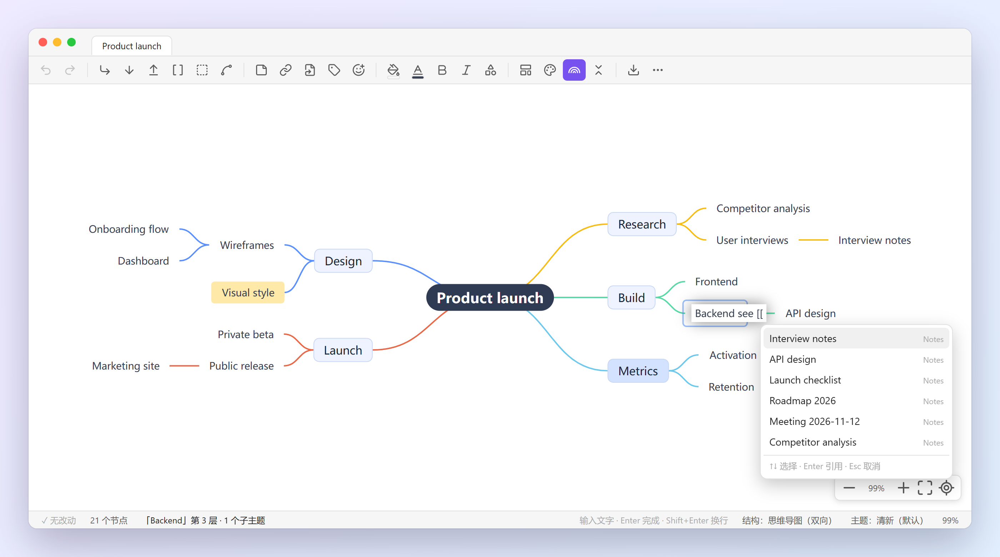

# CloudMind 中文说明

[English](README.md) | **简体中文**

在 Obsidian 里像 XMind 一样画思维导图，而数据就是你的 **Markdown 笔记本身**：标题和列表的层级就是导图的层级，在导图里改，改的就是这份 `.md`，不导出、不转换。

> 仅支持桌面版 Obsidian（1.5.0 及以上），界面为简体中文。



## 目录

- [安装](#安装)
- [创建导图](#创建导图)
- [编辑导图](#编辑导图)
- [主题与结构](#主题与结构)
- [引用笔记 \[\[双链\]\]](#引用笔记-双链)
- [导出](#导出)
- [笔记是怎么存的](#笔记是怎么存的)
- [设置](#设置)
- [快捷键一览](#快捷键一览)
- [常见问题](#常见问题)

## 安装

### 从插件市场安装（上架后）

设置 → 第三方插件 → 浏览，搜 **CloudMind**，安装并启用。

### 手动安装（现在可用）

1. 打开 [Releases](https://github.com/Be1Human/obsidian-cloudmind/releases/latest)，下载最新版的 3 个文件：`main.js`、`manifest.json`、`styles.css`（不用下载 Source code）。
2. 在库里新建文件夹 `.obsidian/plugins/cloudmind/`，把 3 个文件放进去：

   ```
   你的库/
   └─ .obsidian/plugins/cloudmind/
        ├─ main.js
        ├─ manifest.json
        └─ styles.css
   ```

3. 设置 → 第三方插件，点“已安装插件”旁的刷新按钮，打开 **CloudMind**。首次启用会提示“CloudMind 已启用”。

> - Mac 上 `.obsidian` 是隐藏文件夹，在 Finder 里按 `⌘ ⇧ .` 显示。
> - 文件夹名必须是 `cloudmind`（和 manifest 里的 id 一致）。
> - 更新：用新版本的 3 个文件覆盖，再重启 Obsidian 或重新打开插件。

## 创建导图

以下都是装好 CloudMind 后在 Obsidian 里的真实截图，红框是要点的位置。

### 新建一张导图（任选一种）

**① 左侧栏的 CloudMind 图标 → 新建思维导图**



**② 在文件列表里右键文件夹 → CloudMind：新建思维导图**（导图会建在这个文件夹里）



**③ `Ctrl+P` 打开命令面板，搜 CloudMind → 新建思维导图**



新建后会生成 `未命名导图.md`（同名时依次为 `未命名导图 1.md`…），里面是一个中心主题和三个分支，并直接以导图打开。像普通笔记一样改名即可。



### 把已有笔记变成导图

**④ 点笔记右上角的导图按钮**，或 **⑤ 点底部状态栏的“CloudMind · 点击以导图预览”**。也可以在文件列表里右键笔记 → CloudMind：以思维导图预览。





- **只预览不会改动文件**，在导图里编辑之后才会写回。
- 想让某篇笔记**每次都以导图打开**：在笔记开头的属性（frontmatter）里加一行 `cloudmind: true`。新建的导图已经自带。
- 切回文字：左侧栏 CloudMind 图标 → 切回文本，或点底部状态栏，或命令“将当前思维导图切回文本”。

## 编辑导图

| 想做什么 | 怎么做 |
|---|---|
| 加子主题 / 同级主题 / 父主题 | 选中节点按 `Tab` / `Enter` / `Shift+Tab`，或用工具栏按钮 |
| 改文字 | 选中后直接打字，或按 `F2`、双击；`Enter` 结束编辑 |
| 删除 | `Del` 或 `Backspace`；`Shift+Backspace` 只删当前节点、保留子节点。中心主题不能删 |
| 调整位置 | 拖动节点；或 `Ctrl+↑` / `Ctrl+↓` 上下移动 |
| 折叠 / 展开 | 选中按 `/`，或点节点旁的展开 / 收起按钮 |
| 撤销 / 重做 | `Ctrl+Z` / `Ctrl+Y` |
| 样式 | 选中节点后用上方的快捷条或右键菜单：填充颜色、文字颜色、边框颜色、形状、加粗、斜体、图标 |
| 备注、链接、标签 | 工具栏的“备注”“链接”“标签”按钮，或右键菜单 |
| 概要、外框、关联线 | 工具栏“概要”（`Ctrl+G`）、“外框”，右键菜单“关联线” |
| 平移 / 缩放 | 拖动空白处或滚轮平移；`Ctrl` + 滚轮缩放（触控板双指同样可用）；`Ctrl+I` 适应画布 |

**工具栏**默认在顶部，可以停靠在上下左右、悬浮拖动或隐藏：点工具栏最右边的“设置”按钮，或在插件设置里改。悬浮时拖动左边的抓手移动，双击抓手回到默认位置。

**选中节点**时，节点旁会浮出快捷条（加子主题、颜色、加粗、备注、删除等），会自动避开其它节点。

**底部状态栏**显示保存状态、节点数、当前选中、操作提示、结构、主题和缩放，点“主题”“结构”可以直接切换。

## 主题与结构

点工具栏的 **主题** 按钮，会打开带缩略图的主题面板，共 10 套：

| 方块系列（每个节点都有方框） | 其它风格 |
|---|---|
| 方块、方块·彩色、方块·深色、方块·蓝图 | 清新（默认）、商务、深色、极简线条、马卡龙、暖纸 |



点 **结构** 按钮可切换 8 种结构：思维导图（双向）、逻辑图（向右 / 向左）、组织结构图、目录组织图、时间轴、竖向时间轴、鱼骨图。

- 主题和结构**记在这篇笔记里**，每篇可以不同。
- 主题面板底部的“跟随 Obsidian 明暗”会随 Obsidian 的浅色 / 深色自动切换。
- 给节点手动填了浅色时，文字颜色会自动调成看得清的深色（只影响显示，不写进笔记）。

## 引用笔记 [[双链]]

编辑节点文字时输入 `[[`，会弹出库里的笔记列表：

- `↑` `↓` 选择，`Enter` 插入，`Esc` 取消，继续打字可以筛选。
- 也可以选中节点后点工具栏的“引用”按钮。
- 含链接的节点会显示下划线，**`Ctrl` + 点击节点**在新标签页打开那篇笔记。
- 写进文件的是标准的 `[[笔记名]]`，Obsidian 的反向链接、关系图谱都能识别。



## 导出

工具栏 **导出** 按钮：

- **PNG 图片**、**SVG 矢量图**、**.xmind 文件**（可以用 XMind 打开）。
- 导出的文件保存在**导图笔记所在的文件夹**，文件名和笔记同名，例如 `读书/原子习惯.png`。

## 笔记是怎么存的

全部存在这一份 `.md` 里，没有任何附加文件：

```markdown
---
cloudmind: true
cloudmind-layout: logicalStructure
cloudmind-theme: cloudBox
---
# 周末计划
## 学习
- 读完《原子习惯》
- 整理 [[读书清单 2026]]
## 运动 <!--mm:{"fillColor":"#C9F0DE"}-->
- 跑步 5 公里
  这一行是“跑步 5 公里”的备注
```

| 内容 | 存在哪里 |
|---|---|
| 层级结构 | `#` 标题和 `-` 列表的嵌套 |
| 节点备注 | 节点下面的普通文字行 |
| 颜色、折叠、图标、概要、链接等样式 | 行尾的 `<!--mm:{…}-->` 注释，阅读模式里看不见 |
| 整张图的结构、主题、彩虹分支线 | frontmatter：`cloudmind-layout`、`cloudmind-theme`、`cloudmind-rainbow` |
| 是否以导图打开 | frontmatter：`cloudmind: true` |

所以：

- 关掉插件，笔记照样是能读的标题和列表。
- 全文搜索、反向链接、关系图谱、同步（iCloud / 坚果云 / Git）都和普通笔记一样。
- 想让一篇已有的长笔记变成导图，只要它是用标题和列表写的就行。

## 设置

设置 → 第三方插件 → CloudMind：

| 设置 | 说明 | 默认 |
|---|---|---|
| 工具栏位置 | 顶部 / 底部 / 左侧 / 右侧 / 悬浮（可拖动）/ 隐藏 | 顶部 |
| 图标大小 | 标准 / 紧凑 | 标准 |
| 按钮显示文字 | 在图标旁显示按钮名称，刚上手更容易找 | 关 |
| 节点快捷条 | 选中节点时在旁边浮出常用操作 | 开 |
| 底部状态栏 | 显示保存状态、节点数、提示、结构、主题、缩放 | 开 |
| 自动用导图打开 | 带 `cloudmind: true` 的笔记打开时自动显示为导图 | 开 |

## 快捷键一览

| 按键 | 作用 |
|---|---|
| `Tab` | 添加子主题 |
| `Enter` | 添加同级主题（编辑时为结束编辑） |
| `Shift+Tab` | 在上方插入父主题 |
| 直接打字 / `F2` | 编辑选中节点 |
| `Del` / `Backspace` | 删除节点（含子节点） |
| `Shift+Backspace` | 只删当前节点，保留子节点 |
| `/` | 折叠 / 展开 |
| `Ctrl+G` | 添加概要 |
| `Ctrl+B` | 加粗 |
| `Ctrl+↑` / `Ctrl+↓` | 上移 / 下移 |
| `Ctrl+C` / `Ctrl+X` / `Ctrl+V` | 复制 / 剪切 / 粘贴节点 |
| `Ctrl+Z` / `Ctrl+Y` | 撤销 / 重做 |
| `Ctrl+A` | 全选 |
| `Ctrl+L` | 整理布局 |
| `Ctrl+I` | 适应画布 |
| `Ctrl` + 点击节点 | 打开节点里引用的笔记 |
| `Ctrl` + 滚轮 | 缩放 |

Mac 上把 `Ctrl` 换成 `⌘`。

## 常见问题

**装好后看不到 CloudMind？**
确认文件夹名是 `cloudmind`、里面有 3 个文件，并且在第三方插件里点了刷新、打开了开关。如果开着“安全模式”，需要先关闭。

**为什么我的笔记没有自动以导图打开？**
只有 frontmatter 里带 `cloudmind: true` 的笔记才会自动打开为导图；其它笔记点右上角的导图按钮预览。也可能是在设置里关了“自动用导图打开”。

**导图会不会把我的笔记格式弄乱？**
只预览不会改动文件。在导图里编辑后，会按“标题 + 列表”重新写回，并在行尾加上样式注释。不想改动的笔记，建议只预览不编辑；需要的话先备份或用 Git 管理。

**和其它思维导图插件冲突吗？**
CloudMind 只认 `cloudmind` 这个标记，带其它插件标记（如 `mindmap-plugin`）的笔记不会被自动接管。

**手机上能用吗？**
暂不支持，目前只支持桌面版。

**删除键没反应？**
请更新到 0.4.2 及以上：旧版本在中文输入法开着时，`Backspace` 会被当成打字而不是删除。

**遇到问题或想要新功能？**
在 [Issues](https://github.com/Be1Human/obsidian-cloudmind/issues) 里反馈，附上 Obsidian 版本、CloudMind 版本和复现步骤。

## 开源协议

[MIT](LICENSE)。基于 [simple-mind-map](https://github.com/wanglin2/mind-map)（MIT）。与 XMind 公司无关，详见 [THIRD_PARTY_NOTICES.md](THIRD_PARTY_NOTICES.md)。
